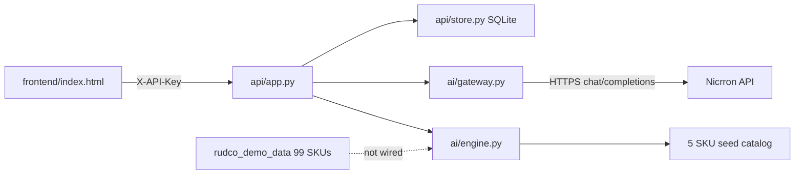

# Build status & next plan

**Last verified:** 2026-10-10 against local `uvicorn` on `127.0.0.1:8000` with a real Nicrron key.  
**Automated tests:** `pytest -q` → **5 passed**.

This is the single source of truth for *what works today* vs *what is still missing*. Party docs (`api.md`, `ai.md`, `frontend.md`) describe ownership; this file describes **runtime status**.

---

## Stack context (`requirements.txt`)

| Dependency | Why it is in the product |
|---|---|
| `fastapi` + `uvicorn` | B2B REST API + local server |
| `pydantic` | Request models + Nicrron JSON validation |
| `python-dotenv` | Local `.env` for Nicrron / API keys |
| `python-multipart` | RFQ file upload (`/v1/rfqs/upload`) |
| `pymupdf` | Extract text from PDF uploads |
| `openpyxl` | Extract text from XLSX uploads |
| `httpx` | Real HTTPS calls to Nicrron `/chat/completions` |
| `pytest` | API contract tests (network stubbed only in tests) |

No frontend framework, no OpenAI SDK, no OCR library.

---

## Status legend

| Status | Meaning |
|---|---|
| **Works** | Exercised live in this verification |
| **Partial** | Code path exists but fails / incomplete in common cases |
| **Not built** | UI/API surface missing or decorative only |

---

## What works (verified live)

| Capability | Evidence |
|---|---|
| Server boot + health | `GET /health` → `configured: true`, model `nicrron/auto` |
| Live Nicrron ping | `POST /v1/gateway/test` → `connected: true` (resolved model e.g. `anthropic/claude-haiku-4-5`) |
| Text RFQ → extract → match | Sample 2-line RFQ → `parser_mode: nicrron_live`, line 1 SKU `SS-304-16GA-4896` |
| Clarification + revalidate | `PATCH` grade/width/length → line 2 `SS-316-125-4896`, `ready_for_approval` |
| Approve + quote draft | Both lines approved → quote `demo_draft`, `ready_to_send: false`, total `$9922.50` |
| Small file upload | `.txt` upload via `/v1/rfqs/upload` → live extract + match |
| File text parsers | Demo `.eml` / `.pdf` / `.xlsx` extract readable text locally (pymupdf/openpyxl) |
| Catalog API (seed) | `GET /v1/catalog/items` → **5** synthetic SKUs |
| Auth gate | Missing `X-API-Key` → **401** |
| Webhook guard | Clarification dispatch without env secrets → **412** (does not fake email send) |
| Unit/API tests | `pytest` stubs `_completion` only inside tests; quote flow covered |

Happy-path demo narrative for judges **works** on the sample text RFQ.

---

## Partial / flaky

| Capability | What we saw | Why |
|---|---|---|
| **Upload larger demo RFQs** | `.eml` → model returned invalid JSON (**502**); `.pdf` / `.xlsx` → Nicrron **timeout** | Upload + text extraction run, then the **same live model call** as text RFQs. Longer messy RFQs exceed timeout / produce bad JSON. Default `NICRRON_TIMEOUT_SECONDS=40`. |
| **Model selection** | Model is fixed from `.env` as `NICRRON_MODEL=nicrron/auto` | Nicrron *router* may pick an underlying model (shown in responses), but **there is no UI or API to choose a model per request**. Changing model requires editing `.env` and restarting. |
| **Runtime catalog vs demo dataset** | Runtime seed = **5 SKUs** in `ai/engine.py` | [`rudco_demo_data/`](../rudco_demo_data/) has **99 SKUs** + 4 rich RFQs + answer key — **not wired** into the live app store. Uploading those RFQs will mostly fail to price even if extraction succeeds. |
| **Clarification email** | Draft endpoint exists; dispatch needs webhook env | No out-of-the-box email; intentional for the hackathon demo. |

---

## Not built

| Gap | Notes |
|---|---|
| **Frontend model picker** | No `<select>` / model field in [`frontend/index.html`](../frontend/index.html). Cannot switch models from the UI. |
| **Per-request model override** | `POST /v1/rfqs` body has no `model` field; gateway always reads `NICRRON_MODEL`. |
| **Sidebar pages** | Overview / Supplier Catalog / Pricing & Compliance / API Integration are **decorative nav** — no click handlers, no routes, no pages. |
| **Catalog UI** | Catalog only via REST (`GET/PUT /v1/catalog/items`), not in the workspace UI. |
| **OCR for scanned PDFs** | Text-layer PDFs only; no OCR dependency in `requirements.txt`. |
| **Live market pricing** | Seeded synthetic costs/benchmarks only; quotes stay `demo_draft`. |
| **Production auth / multi-tenant** | Demo API keys in env JSON; local SQLite only. |
| **Wire `rudco_demo_data` into runtime** | Dataset is for eval/demo narrative, not loaded by `store.init()`. |

---

## Architecture (current)



---

## Recommended next plan (priority order)

### P0 — Demo reliability
1. **Raise timeout / chunk long RFQs** so demo `.eml` / `.pdf` / `.xlsx` uploads complete more often (or truncate with a clear user message).
2. **Surface model used** clearly in UI (already in response) and document that `nicrron/auto` is router-selected, not user-chosen.

### P1 — Product gaps people expect
3. **Model choosing (if judges care):** add optional `model` on RFQ request + a simple frontend dropdown (still server-side only; never expose Nicrron key). Keep default `nicrron/auto`.
4. **Wire or subset `rudco_demo_data` catalog** into runtime so uploaded demo RFQs can match more than 5 SKUs — or ship a one-click “load demo catalog” API.
5. Either **implement sidebar sections** (at least Catalog list) or **remove dead nav** so the UI matches reality.

### P2 — Hardening
6. Retries / clearer 502 messages when Nicrron returns truncated JSON.
7. Optional OCR path (new dependency) for scanned PDFs — only if track scoring needs it.
8. Eval harness against `rudco_demo_data/rfqs/answer_key.csv`.

---

## Quick re-verify commands

```bash
source .venv/bin/activate
uvicorn app:app --reload --host 127.0.0.1 --port 8000

curl -s http://127.0.0.1:8000/health | python3 -m json.tool
curl -sS -X POST http://127.0.0.1:8000/v1/gateway/test -H 'X-API-Key: rudco-demo-key' | python3 -m json.tool
bash examples/live_request.sh
pytest -q
```

---

## Bottom line

**Built and working:** live Nicrron extraction, sample text RFQ → clarify → approve → `demo_draft` quote, small uploads, catalog API, auth, tests.  
**Not working / missing as users expect:** in-app **model choosing**, reliable **large document** extraction through the model, wiring the rich **demo dataset**, and real **sidebar/catalog UI**.
